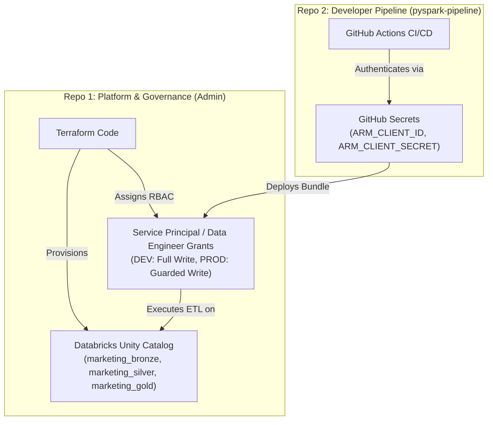

# Developer Repository Setup Guide: `pyspark-pipeline`

This guide provides complete, end-to-end instructions for creating and setting up **Repo 2 (`pyspark-pipeline`)**. You can open a new session in that folder and feed this document directly to your AI assistant.

---

## 1. How Repo 2 Inherits Permissions from Repo 1 (The Enterprise Security Model)

A common question is: *How does the new developer repo inherit permissions from the platform admin repo?*



### The Key Takeaways:
1. **Permissions Live in Unity Catalog, NOT in Git**:
   - The Admin Repo (`Databricks_CI_CD_apps`) already codified and applied the schemas, compute policies, and RBAC grants inside Databricks.
2. **Authentication via Identity**:
   - Repo 2 authenticates to Databricks using the **same Azure Service Principal** (`ARM_CLIENT_ID` / `ARM_CLIENT_SECRET`) or Databricks OAuth token stored in its GitHub Secrets.
3. **Automatic Enforcement**:
   - When Repo 2 deploys Databricks Asset Bundles (DABs), Databricks validates the caller against the Unity Catalog rules that Repo 1 created.
   - In **DEV**: The pipeline can read, transform, and write data into `marketing_bronze` and `marketing_silver`.
   - In **PROD**: The pipeline runs automated scheduled jobs under the service principal, while human developers remain strictly read-only.
   - Data engineers in Repo 2 **never need cloud permissions, Azure portal access, or Terraform**. They just write PySpark code!

---

## 2. Step-by-Step: How to Create the New Repository

### Step A: Create GitHub Repo
1. Go to **[GitHub: Create a new repository](https://github.com/new)**.
2. Repository name: **`pyspark-pipeline`**.
3. Visibility: **Public** (or Private).
4. Do **not** check README, .gitignore, or license (leave empty).
5. Click **Create repository**.

### Step B: Create Local Folder & Initialize Git
Open your local terminal (PowerShell or Bash) and run:

```bash
# 1. Navigate to your parent projects directory
cd C:\Users\balak\GitProjects\dataEngineering_projects

# 2. Create the new folder and enter it
mkdir pyspark-pipeline
cd pyspark-pipeline

# 3. Initialize git repository
git init -b dev
```

---

## 3. Recommended Project Structure for `pyspark-pipeline`

Inside `pyspark-pipeline`, set up the following directory structure:

```text
pyspark-pipeline/
├── .github/
│   └── workflows/
│       └── deploy.yml              # CI/CD: Runs pytest on PR, deploys DABs on merge
├── src/
│   ├── __init__.py
│   └── etl/
│       ├── __init__.py
│       └── transformations.py     # Pure PySpark transformations (Bronze -> Silver)
├── tests/
│   ├── __init__.py
│   ├── conftest.py                # Local SparkSession fixture for testing
│   └── test_transformations.py    # Unit tests with pytest
├── databricks.yml                 # Databricks Asset Bundle (DABs) configuration
├── pytest.ini                     # Pytest configuration
├── requirements.txt               # Dependencies (pyspark, pytest, chispa)
└── README.md                      # Developer documentation
```

---

## 4. Starter Boilerplate Files

### A. `src/etl/transformations.py`
```python
from pyspark.sql import DataFrame
from pyspark.sql.functions import col, current_timestamp, upper, trim

def clean_marketing_campaigns(df: DataFrame) -> DataFrame:
    """
    Cleans raw marketing campaign data from bronze to silver:
    - Trims whitespace and uppercases campaign names
    - Filters out invalid rows (negative budget or missing campaign_id)
    - Adds an ingestion timestamp column
    """
    return (
        df.filter(col("campaign_id").isNotNull() & (col("budget") > 0))
          .withColumn("campaign_name", upper(trim(col("campaign_name"))))
          .withColumn("processed_at", current_timestamp())
    )
```

### B. `tests/conftest.py`
```python
import pytest
from pyspark.sql import SparkSession

@pytest.fixture(scope="session")
def spark():
    """Provides a local SparkSession for unit testing without cloud clusters."""
    return (
        SparkSession.builder
        .master("local[2]")
        .appName("unit-tests")
        .config("spark.sql.shuffle.partitions", "1")
        .getOrCreate()
    )
```

### C. `tests/test_transformations.py`
```python
from pyspark.sql.types import StructType, StructField, StringType, DoubleType
from src.etl.transformations import clean_marketing_campaigns

def test_clean_marketing_campaigns(spark):
    schema = StructType([
        StructField("campaign_id", StringType(), True),
        StructField("campaign_name", StringType(), True),
        StructField("budget", DoubleType(), True),
    ])

    test_data = [
        ("C1", "  summer_sale  ", 5000.0),
        ("C2", "winter_promo", -100.0),      # Should be dropped (negative budget)
        (None, "invalid_id", 2000.0),         # Should be dropped (null id)
    ]

    input_df = spark.createDataFrame(test_data, schema)
    result_df = clean_marketing_campaigns(input_df)

    assert result_df.count() == 1
    row = result_df.first()
    assert row["campaign_name"] == "SUMMER_SALE"
    assert row["budget"] == 5000.0
```

### D. `databricks.yml` (Databricks Asset Bundle)
```yaml
bundle:
  name: pyspark-pipeline

include:
  - resources/*.yml

targets:
  dev:
    mode: development
    default: true
    workspace:
      host: https://adb-7405605201845024.4.azuredatabricks.net

  prod:
    mode: production
    workspace:
      host: https://adb-7405618385351801.1.azuredatabricks.net

resources:
  jobs:
    marketing_etl_job:
      name: "[${bundle.target}] Marketing Bronze to Silver ETL"
      tasks:
        - task_key: run_transformations
          job_cluster_key: single_node_cluster
          spark_python_task:
            python_file: src/etl/transformations.py
      job_clusters:
        - job_cluster_key: single_node_cluster
          new_cluster:
            spark_version: 14.3.x-scala2.12
            node_type_id: Standard_D4ds_v4
            num_workers: 0
            spark_conf:
              spark.master: "local[*]"
              spark.databricks.cluster.profile: "singleNode"
            custom_tags:
              ResourceClass: "SingleNode"
```

### E. `.github/workflows/deploy.yml`
```yaml
name: Data Pipeline CI/CD

on:
  pull_request:
    branches: [dev, main]
  push:
    branches: [dev, main]

jobs:
  test:
    name: Unit Tests (pytest)
    runs-on: ubuntu-latest
    steps:
      - uses: actions/checkout@v4
      - uses: actions/setup-python@v5
        with:
          python-version: '3.10'
      - name: Install dependencies
        run: |
          pip install --upgrade pip
          pip install -r requirements.txt
      - name: Run unit tests
        run: pytest tests/

  deploy-dev:
    name: Deploy to DEV Databricks
    needs: test
    if: github.ref == 'refs/heads/dev'
    runs-on: ubuntu-latest
    steps:
      - uses: actions/checkout@v4
      - uses: databricks/setup-cli@main
      - name: Deploy Bundle to DEV
        run: databricks bundle deploy -t dev
        env:
          ARM_CLIENT_ID: ${{ secrets.ARM_CLIENT_ID }}
          ARM_CLIENT_SECRET: ${{ secrets.ARM_CLIENT_SECRET }}
          ARM_TENANT_ID: ${{ secrets.ARM_TENANT_ID }}

  deploy-prod:
    name: Deploy to PROD Databricks
    needs: test
    if: github.ref == 'refs/heads/main'
    runs-on: ubuntu-latest
    steps:
      - uses: actions/checkout@v4
      - uses: databricks/setup-cli@main
      - name: Deploy Bundle to PROD
        run: databricks bundle deploy -t prod
        env:
          ARM_CLIENT_ID: ${{ secrets.ARM_CLIENT_ID }}
          ARM_CLIENT_SECRET: ${{ secrets.ARM_CLIENT_SECRET }}
          ARM_TENANT_ID: ${{ secrets.ARM_TENANT_ID }}
```

### F. `requirements.txt`
```text
pyspark==3.5.0
pytest==8.0.0
pytest-cov==4.1.0
chispa==0.9.4
```

---

## 5. GitHub Secrets Needed for `pyspark-pipeline`

Add these 3 repository secrets in `pyspark-pipeline` (Settings &rarr; Secrets and variables &rarr; Actions):
- **`ARM_CLIENT_ID`**: Your Azure Service Principal Client ID
- **`ARM_CLIENT_SECRET`**: Your Azure Service Principal Secret
- **`ARM_TENANT_ID`**: Your Azure Entra ID Tenant ID

*(These are the exact same credentials used in `Databricks_CI_CD_apps`).*

---

## 6. How to Start Your Next Session

When you open your new session in `pyspark-pipeline`:
1. Open the folder `C:\Users\balak\GitProjects\dataEngineering_projects\pyspark-pipeline` in VS Code.
2. Feed this file (`NEW_REPO_SETUP_GUIDE.md`) to your AI assistant.
3. Say: *"Help me initialize the pyspark-pipeline repository using this guide."*
