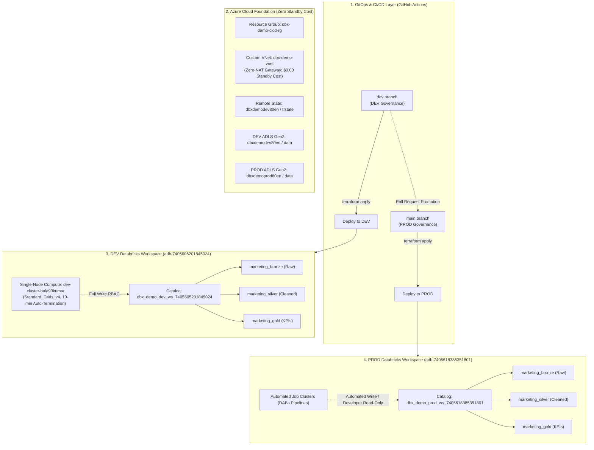
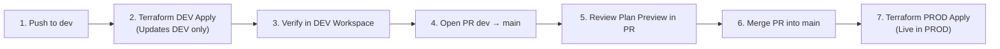

# Enterprise Azure Databricks Platform & Governance (Admin Repo)

This repository is dedicated **100% to Cloud Infrastructure, FinOps Guardrails, and Unity Catalog Governance as Code** for Azure Databricks. 

It implements an enterprise **Two-Repo Architecture**:
- **Repo 1 (`Databricks_CI_CD_apps` - This Repo)**: Cloud networking, storage accounts, workspaces, Unity Catalog schemas, developer onboarding, and admin-managed compute.
- **Repo 2 (`pyspark-pipeline` - Developer Repo)**: PySpark data pipelines, unit testing with `pytest`, and Databricks Asset Bundles (`databricks.yml`).

---

## 🏛️ System Architecture Diagram



---

## 💎 Core Architecture Pillars

### 1. Zero-Standby-Cost Networking & FinOps ($0.00 Idle Cost)
- **Zero-NAT Gateway**: Utilizes VNet Injection with Public IP egress, completely eliminating the ~$32/month standby fee of an Azure NAT Gateway.
- **Auto-Terminating Compute**: Developers use single-node clusters (`Standard_D4ds_v4`, 4 cores, 0 workers) with hardcoded **10-minute auto-termination** (`autotermination_minutes = 10`).
- **Cluster Creation Blocked**: Developers are strictly forbidden from creating custom clusters (`allow_cluster_create = false`).
- **Verified Spend**: Multi-day testing across both DEV and PROD workspaces totaled under ₹20.

### 2. Unity Catalog Medallion Schemas as Code
- **Workspace Catalog Isolation**: Schemas are hosted inside native workspace catalogs to prevent regional metastore cross-pollution.
- **Medallion Layers**:
  - `marketing_bronze`: Raw ingested marketing campaign data.
  - `marketing_silver`: Cleaned, validated, and conformed tables.
  - `marketing_gold`: Business-level aggregations and ROI KPIs.
- **Declarative Reconciliation**: Renaming or updating schemas in Terraform automatically destroys legacy schemas and provisions new ones with zero manual UI clicks.

### 3. Developer Onboarding & Offboarding Lifecycle
- **Declarative Onboarding**: Developers declared as code in `local.data_engineers`:
  ```hcl
  locals {
    data_engineers = [
      {
        email        = "bala93kumar@gmail.com"
        display_name = "Bala Developer"
      }
    ]
  }
  ```
- **Automated Dedicated Compute**: Each developer automatically receives their personal single-node cluster (`dev-cluster-<username>`) with `CAN_RESTART` permissions.
- **Automated Offboarding**: With `force_delete_home_dir = true`, removing or commenting out a developer in code automatically deletes their Databricks user account, revokes all grants, destroys their cluster, and purges their `/Users/<email>` workspace directory.

### 4. RBAC Privileges (DEV Write vs PROD Read-Only)
| Environment | Principal | Privileges | Purpose |
| :--- | :--- | :--- | :--- |
| **DEV** | `data_engineers` (`bala93kumar@gmail.com`) | `USE_SCHEMA`, `SELECT`, `MODIFY`, `CREATE_TABLE` | Active pipeline development and interactive testing |
| **DEV** | `account users` (Admins & Team) | `USE_SCHEMA`, `SELECT` | Visibility and exploratory querying |
| **PROD** | `data_engineers` (`bala93kumar@gmail.com`) | `USE_SCHEMA`, `SELECT` | Strictly Read-Only (Production data protection) |
| **PROD** | Service Principal (`terraform-sp`) | Full Ownership & Pipeline Deploy | Automated CI/CD pipeline execution via DABs |

---

## 🚀 GitOps Promotion Workflow



---

## 📂 Repository Structure

```text
Databricks_CI_CD_apps/
├── .github/
│   └── workflows/
│       └── terraform.yml       # CI/CD: Targeted DEV and PROD Terraform execution
├── terraform/
│   ├── main.tf                 # Azure RG, VNet, Subnets, ADLS Gen2, and Workspaces
│   ├── governance.tf           # Unity Catalog Schemas, Developer Onboarding, Clusters, RBAC
│   ├── variables.tf            # Project variables, locations, and environment settings
│   ├── outputs.tf              # Workspace URLs and storage account outputs
│   └── terraform.tfvars        # Environment-specific configuration
├── HANDOFF_PROMPT.md           # Context & state brief for AI agents
├── NEW_REPO_SETUP_GUIDE.md     # Setup guide for Repo 2 (pyspark-pipeline)
├── Databricks_Platform_CI_CD_Demo.pptx # Executive Presentation Slide Deck
├── PRESENTATION_SPEECH_SCRIPT.txt      # Word-for-word Presenter Talk Script
└── README.md                   # Platform documentation
```
