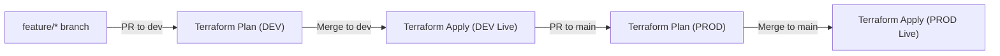

# Azure Databricks Platform & Governance (Admin Repo)

This repository is dedicated **exclusively to Cloud Platform and Infrastructure-as-Code (IaC)** for Azure Databricks and Unity Catalog governance.

Application and PySpark data engineering pipelines are maintained in separate developer repositories.

---

## 🏛️ Architecture & Managed Components

- **Zero-NAT Networking**: Customer-Managed VNet with subnets injected into Databricks workspaces (Zero standby hourly networking costs).
- **Workspaces**: Azure Databricks Premium workspaces for **DEV** and **PROD** environments.
- **Storage**: ADLS Gen2 storage accounts for data containers and remote Terraform state (`tfstate`).
- **Unity Catalog Medallion Schemas**: `retail_silver` and `retail_gold` managed as code.
- **Developer Onboarding & FinOps Guardrails**:
  - Developers onboarded as code (`bala93kumar@gmail.com`) with `allow_cluster_create = false`.
  - Admin-approved shared single-node cluster (`Standard_D4ds_v4`) with 10-minute auto-termination.
- **RBAC Grants**:
  - **DEV**: Full Write Access (`USE_SCHEMA`, `SELECT`, `MODIFY`, `CREATE_TABLE`) for active development.
  - **PROD**: Strictly Read-Only (`USE_SCHEMA`, `SELECT`) for security and governance isolation.

---

## 🚀 CI/CD Promotion Flow

All platform infrastructure and governance changes follow a GitOps pull-request workflow managed by GitHub Actions:

- **Workflow File**: `.github/workflows/terraform.yml`
- **State Locking**: Concurrency guard configured to ensure clean sequential state locking against Azure Blob Storage.
